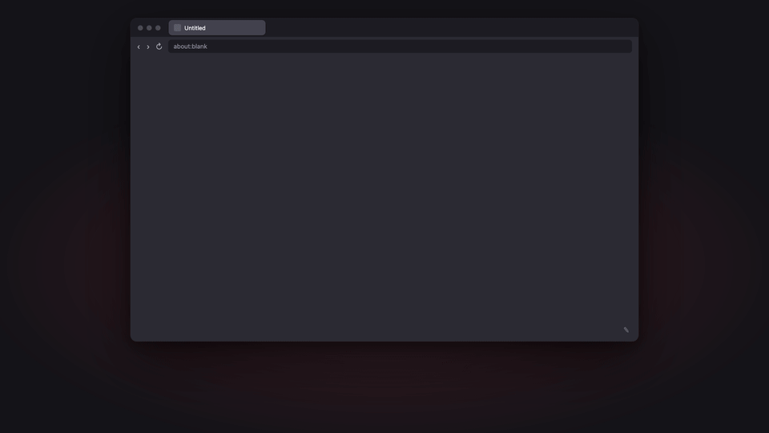

<p align="center"></p>

<h1 align="center">Tack</h1>

<p align="center"><b>A blazing-fast new tab page for Firefox that's just your links.</b><br>
Pin them in an even grid of boxes, tuck a whole row of shortcuts into one box, and take it everywhere with Firefox Sync.</p>

<p align="center"><a href="https://github.com/MJuma/tack/releases/latest/download/tack.xpi"><b>Install for Firefox</b></a> · <a href="#using-it">Using it</a> · <a href="#why-its-fast">Why it's fast</a></p>

<p align="center"></p>

## Install

1. Download [`tack.xpi`](https://github.com/MJuma/tack/releases/latest/download/tack.xpi) from the [latest release](https://github.com/MJuma/tack/releases/latest). Firefox offers to install it.
2. Allow *Access your data for all websites*: Tack only uses it to download each site's favicon and name.
3. Press ⌘T (Ctrl+T). When Firefox says an extension changed your new tab page, choose *Keep changes*.

Tack updates itself. Each release publishes an `updates.json` that Firefox checks about once a day; to check now, use `about:addons` → ⚙ → *Check for Updates*. Tack is signed by Mozilla as an *unlisted* add-on, so it isn't on addons.mozilla.org.

## Why it's fast

Firefox renders its own new tab page in the background before you press Cmd+T, but turns that off whenever an extension takes over the new tab (`NewTabPagePreloading.enabled` checks `!AboutNewTab.newTabURLOverridden`). Every Tack tab loads fresh, so the hot path is kept tiny:

- `newtab.html` inlines its CSS and loads one small classic script, `newtab.js`. There are no frameworks, web fonts or network requests.
- `newtab.js` reads the grid's HTML, pre-rendered by the background page, from `localStorage` (a synchronous read) and sets `innerHTML`. Nothing is awaited, parsed from JSON or built node by node.
- Favicons are already 64px PNG `data:` URLs inside that HTML, decoded with `decoding="sync"` so they land in the first paint.
- The page background is the color Firefox paints behind a tab before it draws (`#f9f9fb` light, `#2b2a33` dark), so there's no flash.
- The editor (`edit.js`, `edit.css`) loads only when you click ✎.

`pnpm measure` times Cmd+T in your installed Firefox (headless, throwaway profile). Firefox 158 on an Apple M3, 30 tabs each:

| Setup | Tab shown (median / p90) | Content painted (median / p90) |
| --- | --- | --- |
| Firefox's own new tab (preloaded) | 17.6 / 25.7 ms | before Cmd+T |
| Empty extension page (the floor for any extension) | 44.7 / 46.5 ms | 41.8 / 44.2 ms |
| Tack, 24 boxes with favicons (81 KB cache) | 44.0 / 46.8 ms | 41.6 / 45.6 ms |

Tack paints as fast as an empty extension page. The gap to Firefox's own page is Firefox loading any extension page without preloading. Address bar focus is unaffected: Firefox treats the new tab URL as a blank page and focuses the address bar, so Cmd+T and typing still works.

## Using it

- **Boxes:** each box shows its site's icon and name, then up to 6 links inside it or its address. Boxes sit in an even grid, up to 6 across. To hide the addresses, untick **Addresses** in the edit toolbar; the choice syncs with your links.
- **Edit:** click ✎ (bottom right). Then:
  - **+ Add a box** fills in the site's name.
  - Click a box to change its address, name or the links inside it.
  - × or Delete removes a box, and the **+** or × on a link inside adds or removes one. Both have Undo.
  - Drag boxes, or focus one and press ⌥← / ⌥→, to reorder.
  - Esc or **Done** leaves edit mode. Every change saves immediately.
- **Links inside:** show them as **Labels** (up to 4) or **Icons** (up to 6). Reorder them by dragging them within their box in edit mode, or in the box's editor by dragging ⠿ or pressing ⌥↑ / ⌥↓ in a field. Links inside are named after the last part of their address, like *Mobile App* for `dev.azure.com/contoso/Mobile%20App`. As icons, a link with its own favicon shows it, and one whose favicon would just repeat the box's shows its first letter.
- **Import → Firefox shortcuts:** adds the shortcuts Firefox's own new tab page showed (pinned ones keep their custom names), skipping any already in Tack. The first time, Firefox asks for permission to read your top sites; Tack doesn't request it at install.
- **Import → JSON file / Export:** `{ "tack": 2, "links": [{ "title": "Azure DevOps", "url": "https://dev.azure.com/", "links": [{ "title": "Mobile App", "url": "https://dev.azure.com/contoso/Mobile%20App" }] }] }`. `"show": "icons"` and `links` are optional. Importing a file also accepts older Tack exports (keys in Tack 0.3.0 files are ignored) or a bare array of links or URL strings, and replaces your current links.
- **Icons:** Tack fetches each site's page and tries the icons it lists, then `/favicon.ico`. Some sites can't be read that way: they set their icon from a script, redirect with a script, or send you to sign in first. For those, Tack takes the icon Firefox shows when you open the site in a tab, as long as the tab's page is the link's site (or under the link's path). If a box has no icon, its editor says why. **Refresh icons** re-downloads every favicon, for example after a site changes its logo, and keeps icons taken from tabs when the site still can't be fetched. Firefox doesn't let extensions reach a few Mozilla sites (`addons.mozilla.org`, `support.mozilla.org` and others), so those show letters.
- **Sync:** links travel with Firefox Sync when **Add-ons** is ticked in Settings → Sync. Each machine downloads its own favicons.
- **Private windows** use Firefox's page unless you allow Tack to *Run in Private Windows* in `about:addons`.

## Development

### Commands

```bash
pnpm dev                  # run Tack in a temporary Firefox profile, reloading on save
pnpm test                 # node:test unit tests for the pure modules
pnpm lint                 # oxlint + web-ext lint
pnpm measure [runs]       # time Cmd+T vs Firefox's page and an empty extension (--headed to watch)
pnpm build                # unsigned zip in web-ext-artifacts/
pnpm sign                 # signed .xpi, with AMO keys from the Keychain (see Releasing)
```

`pnpm lint` reports warnings about `innerHTML`. They're expected: everything Tack renders goes through `escapeHtml` in `src/lib/render.js`, and the tests check it.

### Releasing

Bump `version` in both `src/manifest.json` and `package.json` (CI checks they match) and push to `master`. [`release.yml`](.github/workflows/release.yml) runs the tests and lint, has Mozilla sign the add-on (unlisted), and publishes a GitHub Release `v<version>` with `tack.xpi` and `updates.json`. Pushes that don't change the version don't release. Installed copies pick up the new version through `update_url` in the manifest, which points at the latest release's `updates.json`.

Signing needs two repository secrets, `AMO_JWT_ISSUER` (like `user:12345:67`) and `AMO_JWT_SECRET` (64 hex characters), from <https://addons.mozilla.org/developers/addon/api/key/>. Copy the secret right away: AMO shows it in full only once, then masks it with dots.

Mozilla signs each version number once, so leave signing to CI. `pnpm sign` is for a one-off local build of a version you won't release; it reads the same keys from the macOS Keychain (or `WEB_EXT_API_KEY` / `WEB_EXT_API_SECRET`):

```bash
security add-generic-password -U -s amo-jwt-issuer -a "$USER" -w   # JWT issuer
security add-generic-password -U -s amo-jwt-secret -a "$USER" -w   # JWT secret
```

### How it's put together

| File | Role |
| --- | --- |
| `src/newtab.html`, `src/newtab.js` | The hot path: inline CSS, then paint the cached grid. |
| `src/background.js` | Event page. Wakes when links change (an edit here, or Firefox Sync), re-renders the cache and fetches missing favicons. Also wakes when a tab's favicon changes (and only then), to fill in icons Tack couldn't fetch. |
| `src/lib/store.js` | Links in `storage.sync`: an `order` list of ids plus one `l.<id>` item per box (`t` name, `u` address, `s: 'i'` for icons, `c` links inside), so edits on two machines rarely collide, and a `settings` item for page options. |
| `src/lib/icons.js` | Favicons for boxes and the links inside them, in `storage.local` per machine (Firefox Sync's quota is 100 KB). Fetched from the site or taken from a tab you visited, redrawn at 64px, and flagged when a black or white icon needs inverting to show up. Failures show a letter tile, record why (`e` in the `i:<url>` entry) and retry after a day. |
| `src/lib/page.js` | Reads a page once for its short name and best icon candidates. |
| `src/lib/links.js` | Link data: addresses, links inside, which tabs belong to which link, import and export. Pure. |
| `src/lib/render.js` | Links → grid HTML (with the editor's controls when editing), escaped. Pure, so tests import it directly. |
| `src/lib/cache.js` | Writes the pre-rendered HTML to `localStorage`. Open tabs update through the `storage` event. |
| `src/edit.js`, `src/edit.css` | Edit mode, loaded on demand. |
| `.github/workflows/` | `ci.yml` tests and lints pull requests; `release.yml` signs and releases version bumps. |
